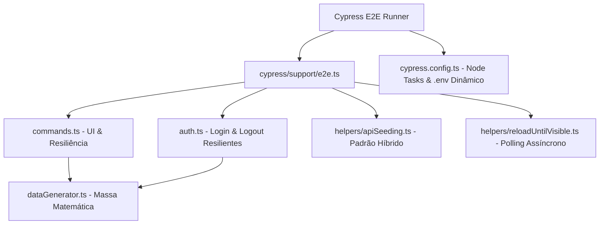

<div align="center">

# ⚡ Best Commands Cypress ⚡
### Cypress Master Automation Toolkit

[](https://www.cypress.io/)
[](https://www.typescriptlang.org/)
[](https://nodejs.org/)
[](https://opensource.org/licenses/MIT)

<p align="center">
  <strong>Boilerplate, Comandos Customizados de Alta Resiliência, Utilitários de Dados Válidos, Helpers de API e Autenticação Concorrente para Projetos Web Modernos (React, Vue, Angular).</strong>
</p>

[Visão Geral](#-visão-geral) •
[Arquitetura](#-arquitetura) •
[Comandos](#-tabela-completa-de-comandos) •
[Utilitários](#-utilitários-e-helpers) •
[Multi-Ambiente](#-ambientes-dinâmicos-multienv) •
[Instalação](#-instalação-e-uso) •
[Boas Práticas](#-boas-práticas-anti-flakiness)

</div>

---

## 🎯 Visão Geral

O **Best Commands Cypress** foi desenvolvido para resolver as principais dores de engenharia em testes End-to-End:
- ❌ **Flaky Tests**: cliques em elementos ainda em animação ou temporariamente desabilitados.
- ❌ **Colisão de Dados**: cadastros duplicados causados por dados estáticos (`teste@email.com`, CPFs fixos).
- ❌ **Sessões Concorrentes**: modais inesperados de *"Usuário já conectado em outro dispositivo"*.
- ❌ **Testes Lentos**: preenchimento moroso de cadastros pela interface gráfica quando poderiam ser semeados via API.
- ❌ **Seletores Frágeis**: acoplamento com classes de CSS ou tags estruturais voláteis.

Com este toolkit, seus testes contam com uma camada de abstração resiliente, totalmente tipada com autocomplete no IDE e pronta para rodar em pipelines de CI/CD.

---

## 🏗️ Arquitetura



### Estrutura do Repositório

```text
Best-Commands-Cypress/
├── .gitignore                  <- Exclusão rigorosa de lixo, caches e segredos
├── CHANGELOG.md                <- Histórico semântico de versões
├── LICENSE                     <- Licença MIT permissiva
├── package.json                <- Scripts e dependências de execução
├── README.md                   <- Guia mestre de referência
├── tsconfig.json               <- Compilação estrita TypeScript 7
├── cypress.config.ts           <- Configuração de timeouts, Node tasks e multi-.env
├── docs/
│   └── EXEMPLOS.md             <- Cenários práticos documentados e comentados
└── cypress/
    ├── config/
    │   └── .env.example        <- Template seguro de variáveis de ambiente
    ├── downloads/              <- Diretório validado via task checkFileExists
    │   └── .gitkeep
    ├── e2e/
    │   └── smoke/              <- Validação de integridade do toolkit
    │       ├── commands.cy.ts
    │       └── dataGenerator.cy.ts
    ├── fixtures/
    │   └── .gitkeep
    └── support/
        ├── e2e.ts              <- Ponto de entrada (commands + auth)
        ├── index.d.ts          <- Declaração TypeScript unificada
        ├── commands.ts         <- Comandos customizados de UI
        ├── auth.ts             <- Login e Logout com tratamento de concorrência
        ├── helpers/
        │   ├── apiSeeding.ts   <- Injeção híbrida via cy.request
        │   └── reloadUntilVisible.ts <- Polling para jobs em segundo plano
        └── utils/
            └── dataGenerator.ts <- Geradores de CPF, CNPJ, Celular, E-mail e Hash
```

---

## ⚡ Tabela Completa de Comandos

Todos os comandos são invocados diretamente via `cy.<comando>` e possuem tipagem estrita com intellisense nativo:

| Comando | Assinatura | O que resolve? | Exemplo de Uso |
|---|---|---|---|
| **`waitForPageLoad`** | `waitForPageLoad(): Chainable<void>` | Evita interações antes do carregamento completo do DOM (`document.readyState === 'complete'`). | `cy.waitForPageLoad();` |
| **`interactWithElement`** | `interactWithElement(selector, action, options?, waitTime?): Chainable<void>` | Unifica ações (`click`, `type`, `clear`, `mouseover`, `containsClick`, `containsSelectorClick`) tratando animações e forçando clique seguro. | `cy.interactWithElement('#txt-nome', 'type', { text: 'Carlos' });` |
| **`clickWhenVisibleAndEnabled`** | `clickWhenVisibleAndEnabled(selector, timeout?, options?): Chainable<void>` | Elimina cliques precipitados aguardando o elemento estar visível E não desabilitado (`not.be.disabled`). | `cy.clickWhenVisibleAndEnabled('#btn-concluir');` |
| **`selectAutocomplete`** | `selectAutocomplete(selector, value, options?): Chainable<void>` | Automatiza seleções complexas em dropdowns modernos (Material UI, Ant Design, Select2) com digitação e busca de `[role="option"]`. | `cy.selectAutocomplete('#combo-cidade', 'São Paulo', { type: true });` |
| **`selectOptionWithText`** | `selectOptionWithText(selector, text, waitTime?): Chainable<void>` | Abre dropdown, localiza item `<li>` pelo texto e pressiona `{esc}` para garantir o fechamento do menu. | `cy.selectOptionWithText('#menu-opcoes', 'Editar Item');` |
| **`clickUntilVisible`** | `clickUntilVisible(targetSelector, clickSelector, options?): Chainable<void>` | Polling de clique: pressiona um botão repetidamente até que o elemento alvo apareça em tela, com timeout e logs limpos. | `cy.clickUntilVisible('.status-aprovado', '#btn-refresh', { timeout: 15000 });` |
| **`validateTextInElement`** | `validateTextInElement(selector, expectedTexts, options?, waitTime?): Chainable<void>` | Valida múltiplos textos de uma única vez dentro de um elemento ou linha de tabela de forma determinística e performática. | `cy.validateTextInElement('.tabela-row', ['PED-900', 'R$ 250,00', 'Pago']);` |
| **`searchForm`** | `searchForm(params): Chainable<void>` | Preenchimento declarativo baseado em schemas para telas de filtros densas com múltiplos inputs e botões de ação. | `cy.searchForm({ fields: [{ selector: '#txt-busca', value: 'Neves' }], btns: ['#btn-filtrar'] });` |
| **`getByTestId`** | `getByTestId(testId, options?): Chainable<JQuery<HTMLElement>>` | Localizador limpo e desacoplado que busca pelo atributo padrão `[data-testid="..."]`. | `cy.getByTestId('btn-salvar').click();` |
| **`getByDataCy`** | `getByDataCy(dataCy, options?): Chainable<JQuery<HTMLElement>>` | Localizador limpo e desacoplado que busca pelo atributo padrão `[data-cy="..."]`. | `cy.getByDataCy('input-email').type('teste@qa.com');` |
| **`fillGeneratedEmail`** | `fillGeneratedEmail(selector, options?): Chainable<void>` | Preenche o campo com e-mail único com garantia matemática de não colisão (`timestamp + hash`). | `cy.fillGeneratedEmail('#txt-email');` |
| **`fillGeneratedPhone`** | `fillGeneratedPhone(selector, options?): Chainable<void>` | Preenche o campo com celular válido no formato brasileiro (com ou sem máscara). | `cy.fillGeneratedPhone('#txt-telefone');` |
| **`fillGeneratedName`** | `fillGeneratedName(selector, prefix?, options?): Chainable<void>` | Preenche o campo com nome empresarial ou pessoal único baseado em prefixo customizável. | `cy.fillGeneratedName('#txt-razao-social', 'Fornecedor');` |
| **`fillGeneratedCPF`** | `fillGeneratedCPF(selector, options?): Chainable<void>` | Gera e preenche um CPF válido com cálculo real de dígitos verificadores e rejeição de números repetidos. | `cy.fillGeneratedCPF('#txt-cpf');` |
| **`fillGeneratedCNPJ`** | `fillGeneratedCNPJ(selector, options?): Chainable<void>` | Gera e preenche um CNPJ válido com cálculo estrito dos dígitos verificadores (filial `0001`). | `cy.fillGeneratedCNPJ('#txt-cnpj');` |
| **`loginPlatform`** | `loginPlatform(email?, password?, options?): Chainable<void>` | Efetua login resiliente na interface: usa fallback de variáveis de ambiente, detecta modal de sessão ativa concorrente e valida saída da tela. | `cy.loginPlatform();` |
| **`logout`** | `logout(options?): Chainable<void>` | Abre o menu de perfil, localiza o botão de logout no DOM atualizado e limpa cookies e localStorage. | `cy.logout();` |

---

## 🧰 Utilitários e Helpers

### 1. `DataGenerator` (`cypress/support/utils/dataGenerator.ts`)
Geração pura de dados sem efeitos colaterais para testes independentes e paralelizáveis:
```typescript
import { DataGenerator } from "../support/utils/dataGenerator";

const cpfComMascara = DataGenerator.cpf(true);        // "123.456.789-01"
const cnpjSemMascara = DataGenerator.cnpj(false);     // "12345678000195"
const emailUnico = DataGenerator.email("usuario");    // "usuario_1729364400000_a1b2@automacao.com"
const telefone = DataGenerator.cellphone(true);       // "(11) 98765-4321"
const hash = DataGenerator.uniqueHash(8);             // "k9x2m4p1"
const textoLimpo = DataGenerator.normalizeText("  Ação   Éxito "); // "acao exito"
```

### 2. `ApiHelper` (`cypress/support/helpers/apiSeeding.ts`)
Padrão Híbrido: acelere seus testes criando dados e autenticando via API antes da asserção de UI:
```typescript
import { ApiHelper } from "../support/helpers/apiSeeding";

// Efetua login via API e já grava o token no localStorage da aplicação
ApiHelper.loginViaAPI("admin@empresa.com", "SenhaForte123!").then((token) => {
  // Injeta massa de dados direto no banco via cy.request
  ApiHelper.seedRecordViaAPI("api/pedidos", { valor: 500 }, token).then((pedido) => {
    cy.visit(`/pedidos/${pedido.id}`);
    cy.validateTextInElement(".pedido-info", [pedido.id, "R$ 500,00"]);
  });
});
```

### 3. `reloadUntilVisible` (`cypress/support/helpers/reloadUntilVisible.ts`)
Espera ativa para processamento em fila ou webhooks assíncronos:
```typescript
import { reloadUntilVisible } from "../support/helpers/reloadUntilVisible";

// Recarrega a página periodicamente até o status mudar
reloadUntilVisible(".status-badge", "Aprovado", {
  maxAttempts: 15,
  intervalMs: 4000,
  initialWaitMs: 2000,
  clickWhenVisible: true,
});
```

---

## 🌐 Ambientes Dinâmicos (Multi-.env)

O toolkit organiza parâmetros de execução em arquivos `.env` dinâmicos por ambiente:

```properties
# cypress/config/.env.example
CYPRESS_BASE_URL=https://qa.suaempresa.com.br
CYPRESS_API_BASE_URL=https://api-qa.suaempresa.com.br
CYPRESS_USER_EMAIL=usuario.qa@empresa.com
CYPRESS_USER_PASSWORD=SenhaSegura123!
```

### Como executar por ambiente:
```bash
# Executa em QA (padrão)
npm run cy:run:qa

# Executa em Homologação / Staging
npm run cy:run:staging

# Executa em Produção
npm run cy:run:prod
```

> [!SECURITY]
> Arquivos contendo senhas e segredos (`.env`, `.env.*`, `cypress/config/.env.*`) são estritamente ignorados pelo `.gitignore`. Apenas o modelo `cypress/config/.env.example` é versionado.

---

## 💻 Instalação e Uso

### Clonar e Rodar Localmente:
```bash
git clone https://github.com/mthsneves/Best-Commands-Cypress.git
cd Best-Commands-Cypress
npm install
```

### Validar Integridade:
```bash
# Validação estática de tipos
npm run typecheck

# Execução headless de todos os testes de fumaça
npm run cy:run

# Abertura interativa do Cypress Runner
npm run cy:open
```

### Como importar este Toolkit em outro projeto existente:
1. Instale as dependências:
   ```bash
   npm i -D cypress typescript dotenv glob cross-env @types/node
   ```
2. Copie a pasta `cypress/support/` para o seu repositório.
3. No seu `cypress.config.ts`, importe a task `checkFileExists` e o leitor de `dotenv`.
4. Garanta que seu `tsconfig.json` inclua `"cypress/support/index.d.ts"`.

---

## 🛡️ Boas Práticas Anti-Flakiness

1. **Evite `force: true` indiscriminadamente**: utilize comandos com espera ativa de habilitado como `clickWhenVisibleAndEnabled`.
2. **Priorize Atributos Desacoplados**: use sempre `cy.getByTestId(...)` ou `cy.getByDataCy(...)` para blindar seus testes contra refatorações visuais.
3. **Massa Isolada e Sem Colisão**: nunca utilize CPFs ou e-mails repetidos. Utilize `DataGenerator` para viabilizar paralelismo e execuções concorrentes limpas.
4. **Padrão Híbrido**: use a UI apenas para testar a experiência do usuário. Toda a massa preliminar deve ser criada via API com `ApiHelper`.

---

## 📄 Licença e Autor

Distribuído sob a licença **MIT**. Veja [LICENSE](LICENSE) para mais detalhes.

Feito com dedicação por **[Matheus Neves](https://github.com/mthsneves)**.  
Contribuições, sugestões e issues são sempre bem-vindas!
